# EnglishSISE — Diagramas UML

Diagramas del estado actual de la app (inicio de sesión con Firebase y pantalla de inicio del Alumno UTCJ).
Para instalar, configurar y mantener el proyecto, consulta el [Manual técnico](MANUAL_TECNICO.md).

Los diagramas están en [Mermaid](https://mermaid.js.org/). GitHub y Android Studio (con el plugin de Markdown)
los muestran directamente.

| # | Diagrama | Qué responde |
|---|---|---|
| 1 | [Casos de uso](#1-diagrama-de-casos-de-uso) | ¿Quién usa el sistema y para qué? |
| 2 | [Clases](#2-diagrama-de-clases) | ¿Qué clases hay y cómo se relacionan? |
| 3 | [Secuencia](#3-diagramas-de-secuencia) | ¿En qué orden se llaman las piezas en cada flujo? |
| 4 | [Actividad](#4-diagrama-de-actividad-validación-del-acceso) | ¿Qué decide la app al iniciar sesión? |
| 5 | [Estados](#5-diagrama-de-estados-navegación) | ¿Cómo se navega entre pantallas? |
| 6 | [Componentes](#6-diagrama-de-componentes) | ¿Cómo se divide la app en capas? |
| 7 | [Despliegue](#7-diagrama-de-despliegue) | ¿Dónde se ejecuta cada parte? |
| 8 | [Modelo de datos](#8-modelo-de-datos-firestore) | ¿Qué se guarda en Firestore? |

---

## 1. Diagrama de casos de uso

Los actores son los cuatro perfiles de RF-01. Los casos con borde punteado están planeados y todavía muestran «próximamente».

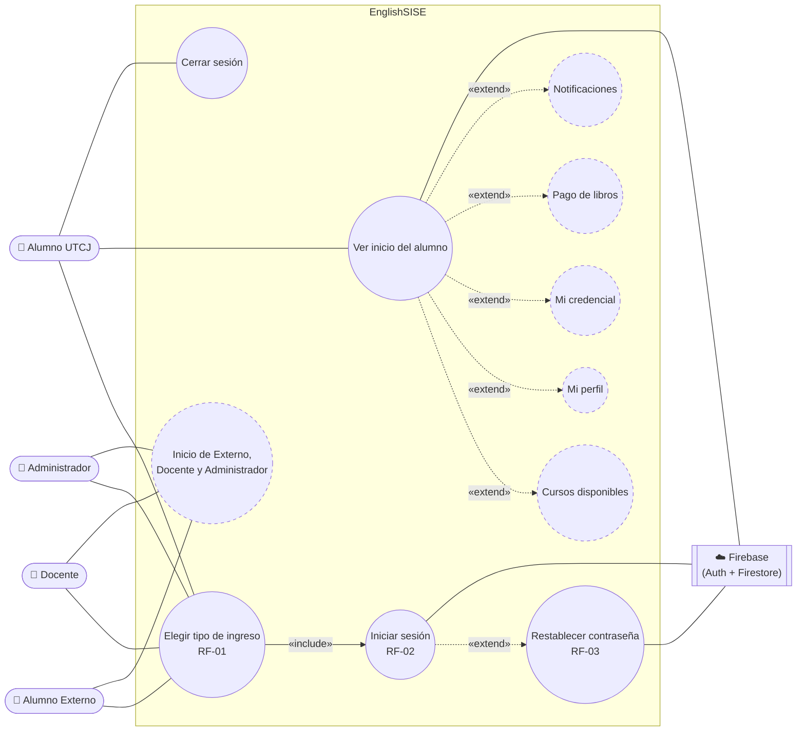

| Caso de uso | Estado | Dónde está |
|---|---|---|
| Elegir tipo de ingreso (RF-01) | ✅ Implementado | `MainActivity` |
| Iniciar sesión (RF-02) | ✅ Los 4 perfiles | `LoginActivity` + `UsuarioRepository.iniciarSesion()` |
| Restablecer contraseña (RF-03) | ✅ Implementado | `UsuarioRepository.restablecerContrasena()` |
| Ver inicio del alumno | ✅ Con nombre y matrícula reales | `InicioAlumnoUtcjActivity` |
| Cerrar sesión | ✅ Menú ☰ o *Más* | `InicioAlumnoUtcjActivity.cerrarSesion()` |
| Cursos, Perfil, Credencial, Pago de libros, Notificaciones | ⏳ «próximamente» | — |
| Inicio de Alumno Externo, Docente y Administrador | ⏳ Valida la cuenta y luego muestra «próximamente» | — |

---

## 2. Diagrama de clases

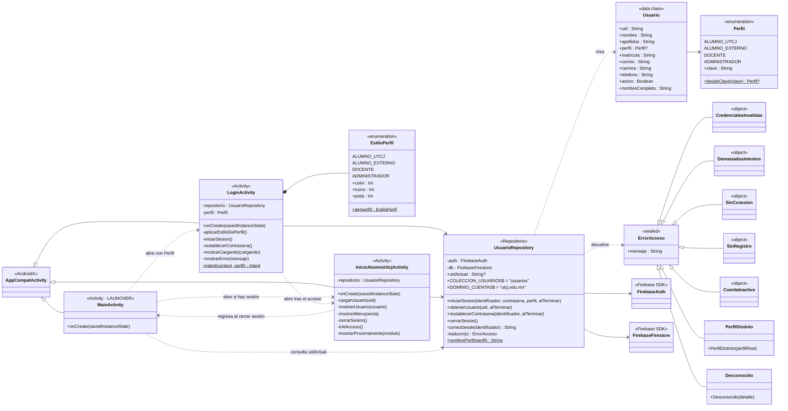

**Notas**

- Los parámetros `alTerminar` son *callbacks* de Kotlin: `(Usuario?, ErrorAcceso?) -> Unit` en `iniciarSesion` y `obtenerUsuario`, y `(ErrorAcceso?) -> Unit` en `restablecerContrasena`. Siempre llega uno de los dos valores, nunca ambos.
- `EstiloPerfil` es un `enum` privado anidado en `LoginActivity`. Relaciona cada perfil con su color, ícono y pista del campo de usuario.
- Las Activities nunca llaman a Firebase directamente: todo pasa por `UsuarioRepository` (RNF-17).

---

## 3. Diagramas de secuencia

### 3.1 Inicio de sesión correcto (Alumno UTCJ)

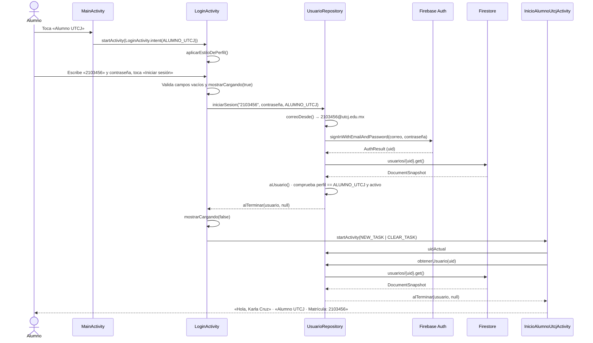

### 3.2 Inicio de sesión rechazado

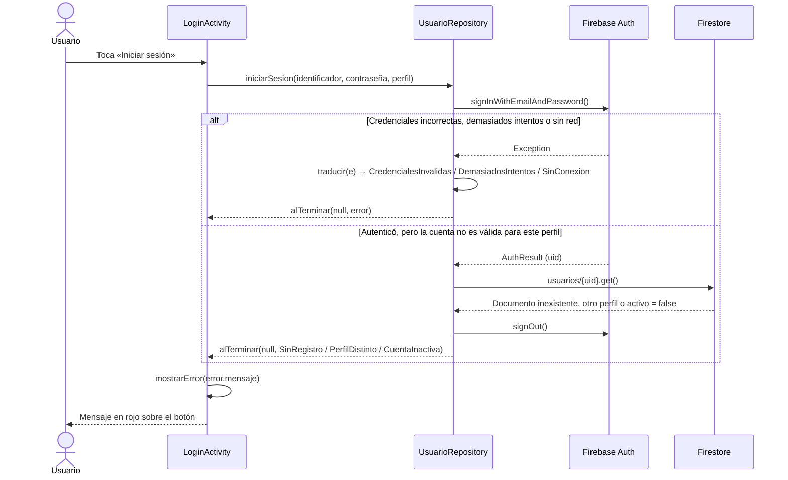

### 3.3 Restablecer contraseña (RF-03)

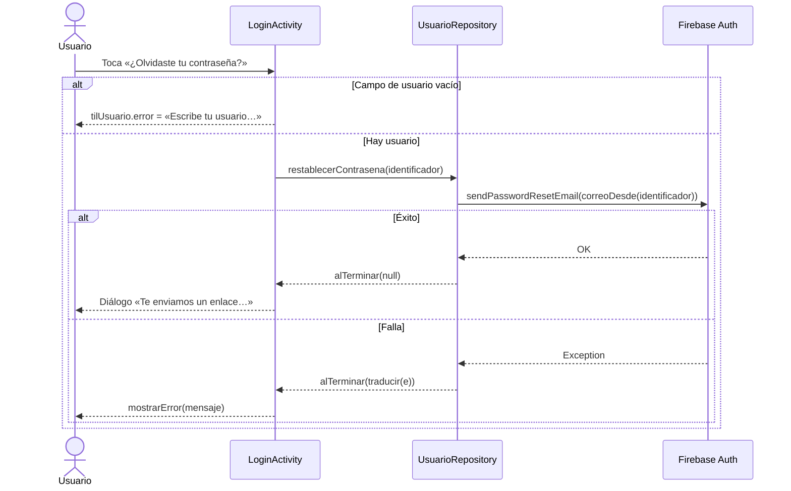

### 3.4 Abrir la app con una sesión guardada

Firebase Auth conserva la sesión entre aperturas. `MainActivity` envía siempre al inicio del Alumno UTCJ, y ahí se valida el perfil.

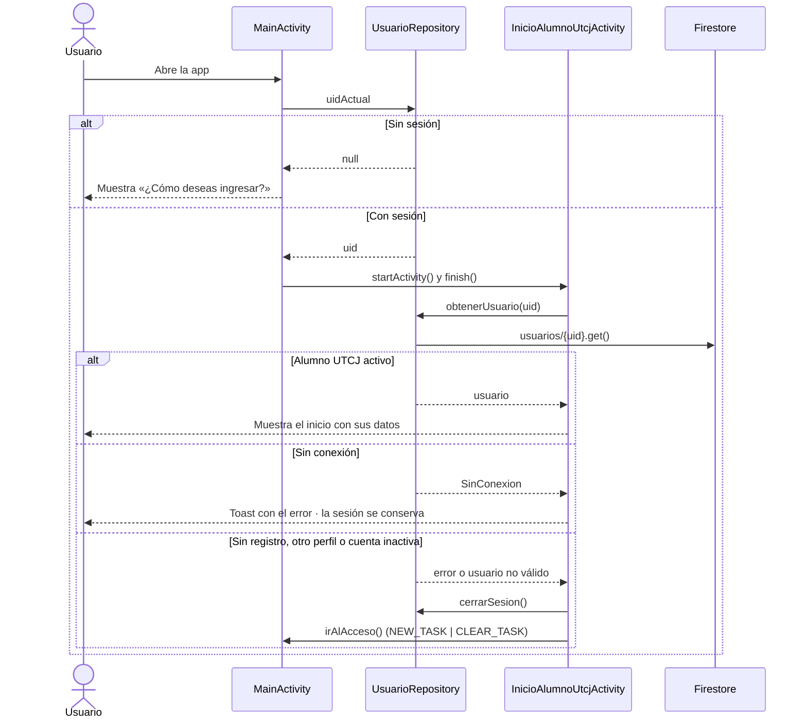

### 3.5 Cerrar sesión

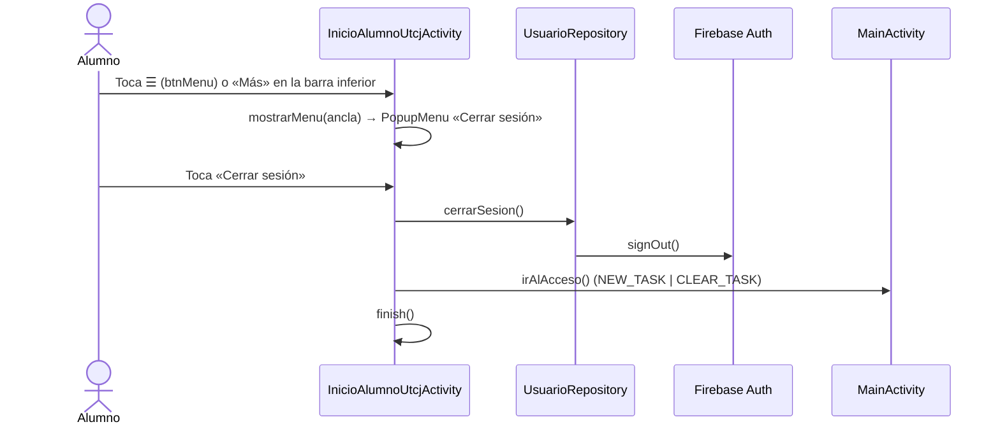

---

## 4. Diagrama de actividad: validación del acceso

Muestra las decisiones de `LoginActivity.iniciarSesion()` y `UsuarioRepository.iniciarSesion()`.

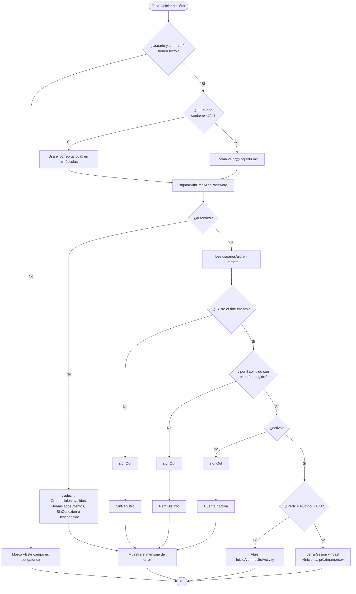

---

## 5. Diagrama de estados (navegación)

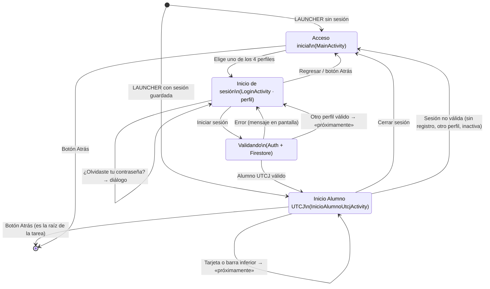

---

## 6. Diagrama de componentes

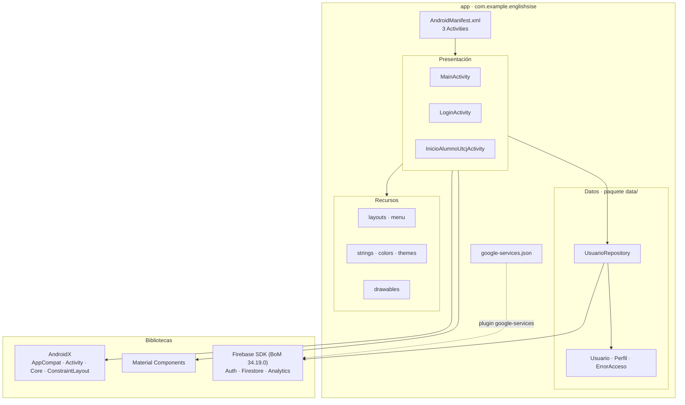

---

## 7. Diagrama de despliegue

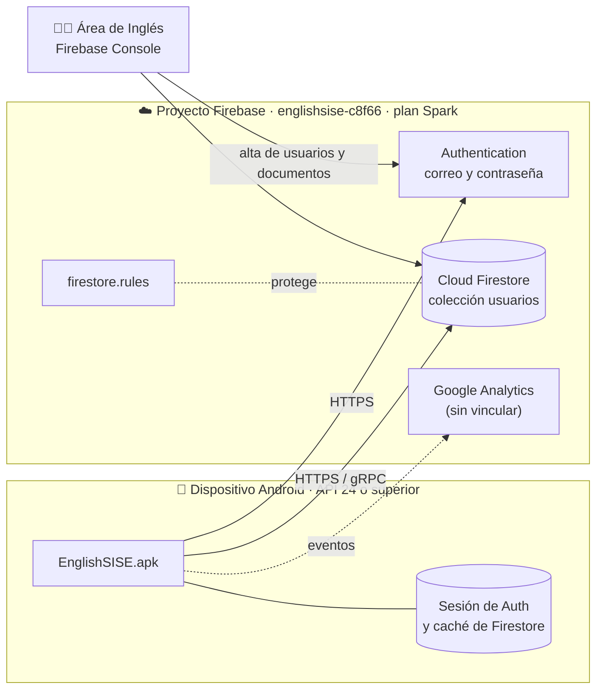

---

## 8. Modelo de datos (Firestore)

Cada cuenta de Firebase Auth tiene un documento en `usuarios` cuyo ID es el `uid` de esa cuenta.

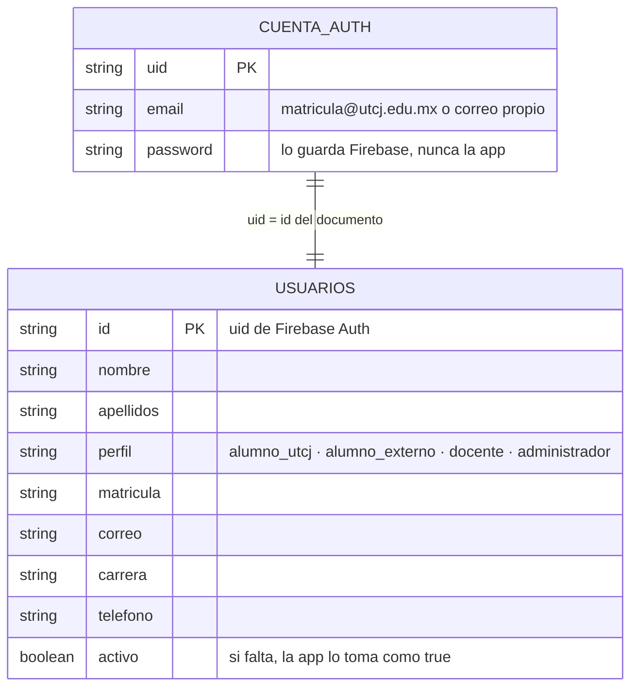

**Permisos (`firestore.rules`)**

| Operación sobre `usuarios/{uid}` | Quién puede |
|---|---|
| Leer | El propio usuario o un Administrador |
| Actualizar | El propio usuario, solo los campos `telefono` y `correo` (RF-05) |
| Crear o borrar | Solo un Administrador |
| Cualquier otra colección | Nadie (cerrado hasta que existan los módulos) |
