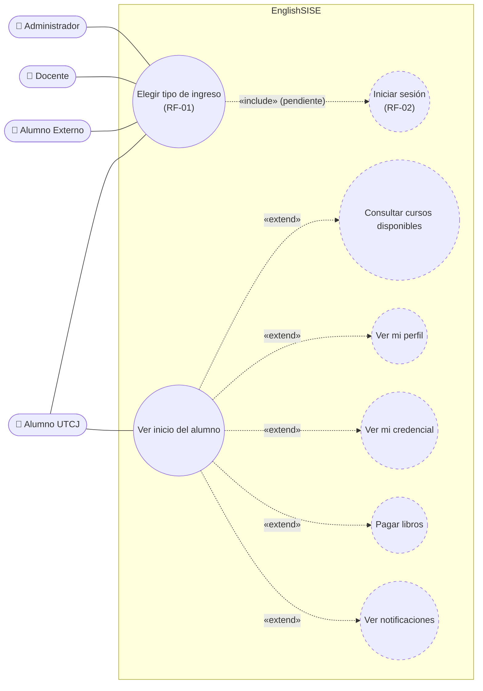
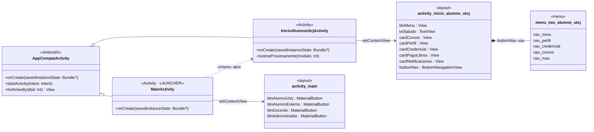
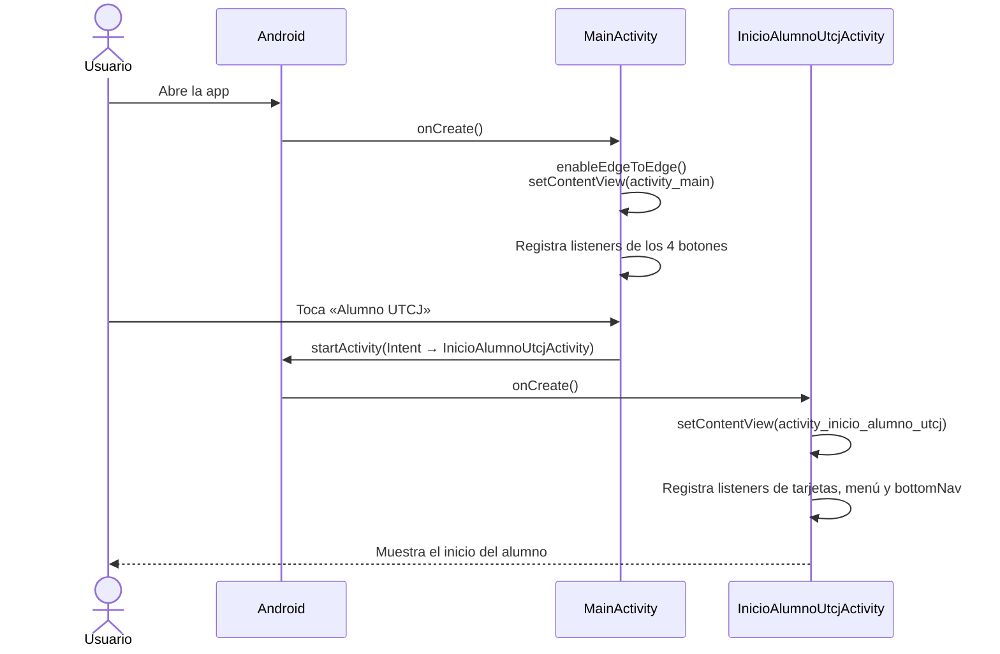
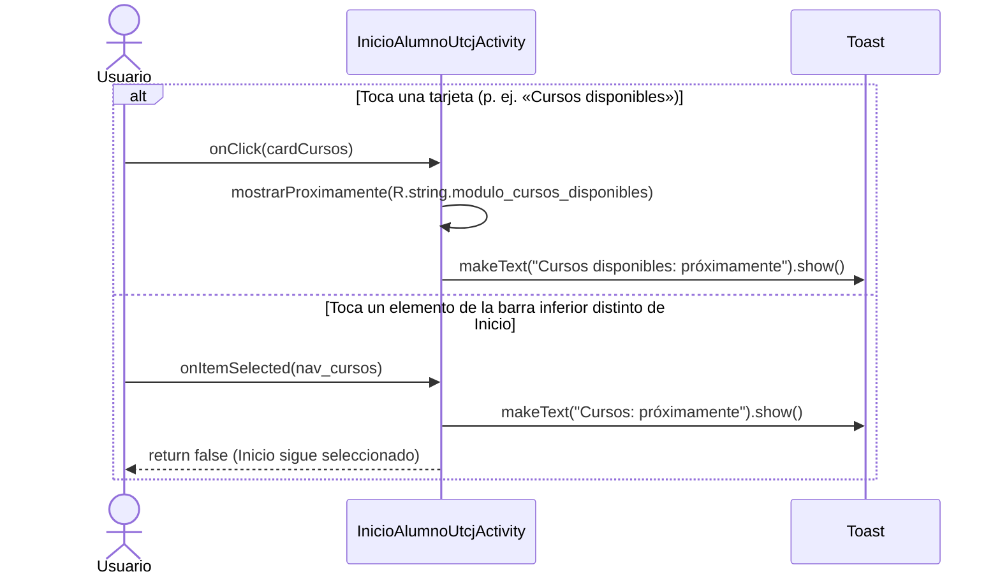
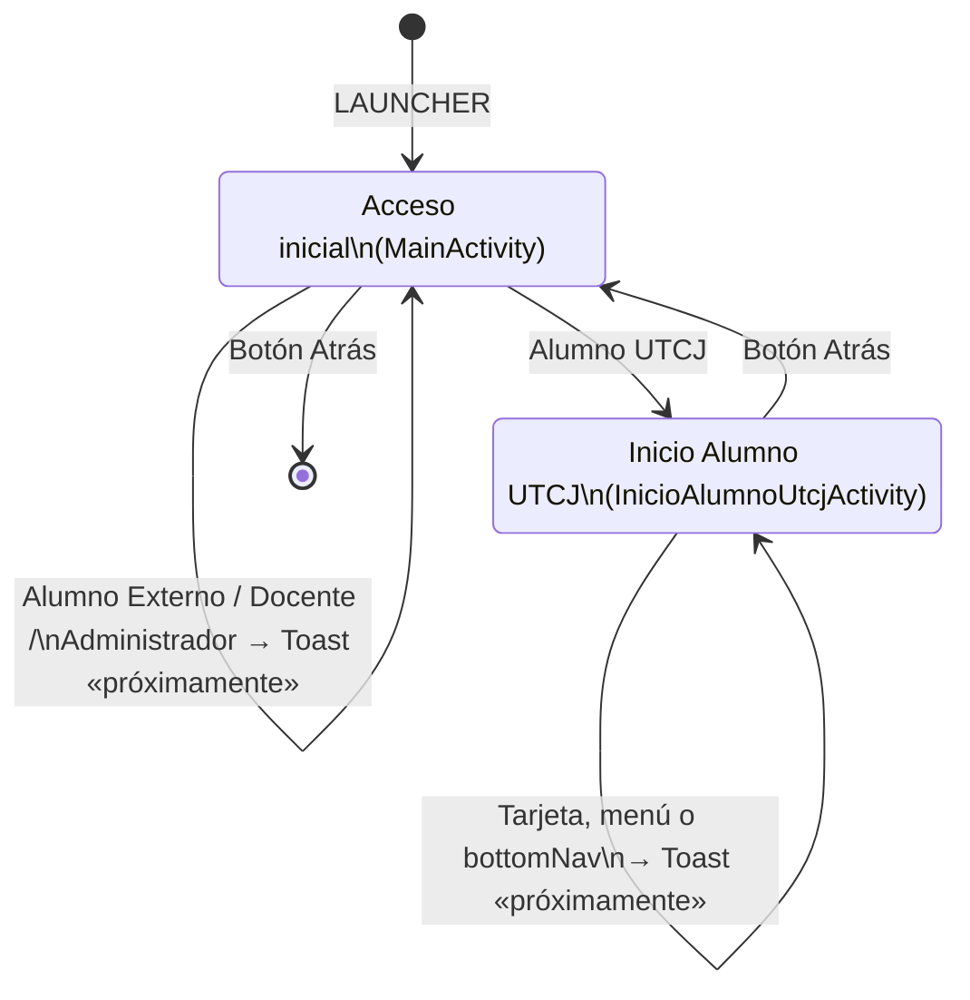
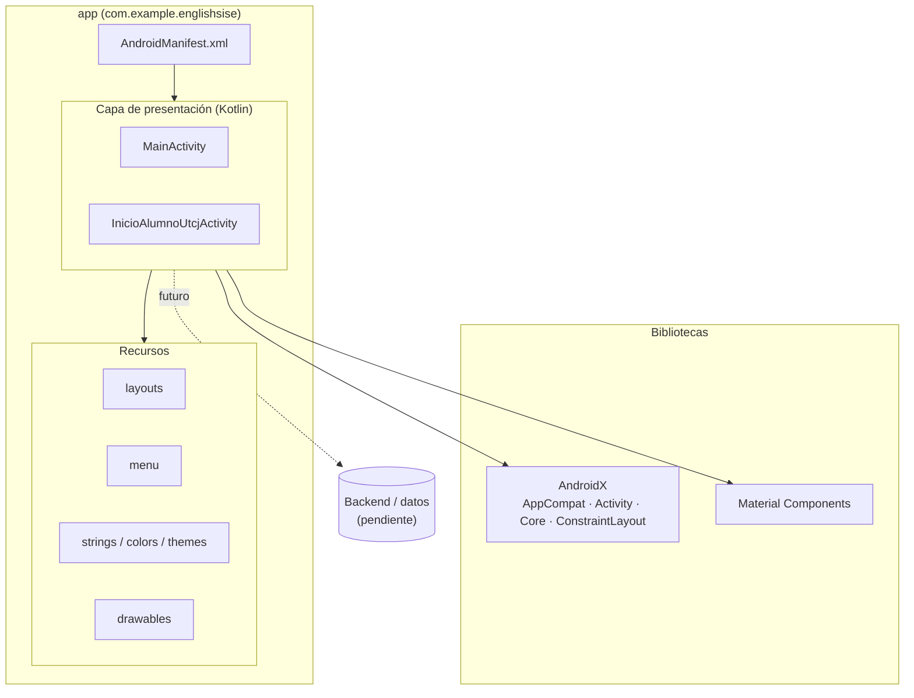

# EnglishSISE — Documentación técnica

**EnglishSISE** es el *Sistema de control de cursos de Inglés* de la Universidad Tecnológica de Ciudad Juárez (UTCJ). Es una aplicación Android nativa escrita en Kotlin.

> **Estado actual: prototipo visual.** Hay dos pantallas: *Acceso inicial* (RF-01) e *Inicio del Alumno UTCJ* (Tabla 4 del ERS). Todavía no hay inicio de sesión (RF-02), datos reales ni backend. Las opciones que aún no existen muestran el mensaje «*X*: próximamente».

Los diagramas están en [Mermaid](https://mermaid.js.org/). GitHub y Android Studio (con el plugin de Markdown) los muestran directamente.

---

## 1. Inicio rápido

| Requisito | Valor |
|---|---|
| IDE | Android Studio (versión reciente) |
| JDK | 11 o superior |
| `minSdk` / `targetSdk` / `compileSdk` | 24 / 37 / 37 |
| Paquete | `com.example.englishsise` |

1. Abre la carpeta del proyecto en Android Studio y espera a que termine la sincronización de Gradle.
2. Elige un emulador o dispositivo con Android 7.0 (API 24) o superior.
3. Ejecuta la configuración **app**. También puedes hacerlo desde la terminal:

```bash
./gradlew installDebug
```

---

## 2. Estructura del proyecto

```
app/src/main/
├── AndroidManifest.xml                 # Declara las 2 Activities; MainActivity es la LAUNCHER
├── java/com/example/englishsise/
│   ├── MainActivity.kt                 # Pantalla 1 · Acceso inicial (RF-01)
│   └── InicioAlumnoUtcjActivity.kt     # Pantalla 2 · Inicio Alumno UTCJ (Tabla 4)
└── res/
    ├── layout/
    │   ├── activity_main.xml           # Botones de tipo de ingreso
    │   └── activity_inicio_alumno_utcj.xml  # Encabezado, tarjetas de módulos y barra inferior
    ├── menu/menu_nav_alumno_utcj.xml   # Elementos de la BottomNavigationView
    ├── drawable/                       # Íconos vectoriales y fondos (gradiente, tarjetas, banner)
    ├── color/nav_item_color.xml        # Selector de color de la barra inferior
    └── values/ (strings, colors, themes)
```

**Dependencias principales:** AndroidX AppCompat, Activity KTX, Core KTX, ConstraintLayout y Material Components (`MaterialButton`, `BottomNavigationView`).

---

## 3. Diagrama de casos de uso

Muestra los actores definidos en RF-01 y lo que cada uno puede hacer. Los casos con línea punteada están planeados pero todavía no se implementan.



| Caso de uso | Estado en el prototipo |
|---|---|
| Elegir tipo de ingreso | ✅ Implementado (`MainActivity`) |
| Iniciar sesión | ⏳ No implementado. *Alumno UTCJ* entra directo a su inicio |
| Ver inicio del alumno | ✅ Implementado (`InicioAlumnoUtcjActivity`) |
| Cursos, Perfil, Credencial, Pago de libros, Notificaciones | ⏳ Solo muestran «próximamente» |
| Accesos de Alumno Externo, Docente y Administrador | ⏳ Solo muestran «próximamente» |

---

## 4. Diagrama de clases



**Responsabilidades**

- **`MainActivity`**: activa el modo *edge-to-edge* y ajusta el padding a las barras del sistema. El botón *Alumno UTCJ* abre `InicioAlumnoUtcjActivity`. Los otros tres botones muestran un `Toast` con el nombre del perfil.
- **`InicioAlumnoUtcjActivity`**: relaciona cada tarjeta de módulo con su texto (`Map<Int, Int>`) y le asigna un listener que llama a `mostrarProximamente()`. En la `BottomNavigationView`, *Inicio* queda siempre seleccionado: el listener devuelve `false` mientras no existan las demás pantallas.

---

## 5. Diagramas de secuencia

### 5.1 Ingreso como Alumno UTCJ



### 5.2 Elegir un módulo que aún no existe



---

## 6. Diagrama de estados (navegación)



---

## 7. Diagrama de componentes



---

## 8. Próximos pasos sugeridos

1. **Inicio de sesión (RF-02):** agregar una pantalla de login entre *Acceso inicial* y cada inicio por perfil.
2. **Módulos del alumno:** crear una Activity o Fragment para Cursos, Perfil, Credencial, Pago de libros y Notificaciones, y conectarlos a las tarjetas y a la `BottomNavigationView`.
3. **Datos reales:** reemplazar el texto fijo `saludo_ejemplo` («Hola, Karla Cruz») por el nombre del usuario autenticado.
4. **Otros perfiles:** pantallas de inicio para Alumno Externo, Docente y Administrador.
5. **Arquitectura:** cuando haya datos, conviene agregar `ViewModel` y repositorios (MVVM) para no meter la lógica en las Activities.
