# EnglishSISE — Documentación técnica

**EnglishSISE** es el *Sistema de control de cursos de Inglés* de la Universidad Tecnológica de Ciudad Juárez (UTCJ).
Es una app Android nativa en Kotlin que usa Firebase como backend.

Este documento reúne en un solo lugar el manual técnico, la configuración de Firebase y los diagramas UML del proyecto.
Es para quien va a **compilar, configurar o modificar** la app.

| Dato | Valor |
|---|---|
| Versión | 1.0 (`versionCode` 1) |
| Paquete | `com.example.englishsise` |
| Proyecto Firebase | `englishsise-c8f66` (plan Spark) |
| Rama de trabajo | `feature/pantallas-acceso-alumno-utcj` |
| Requerimientos | ERS de EnglishSISE (IEEE 830), grupo DSM41 |

---

## Contenido

**Parte I · Manual técnico**

1. [Estado actual](#1-estado-actual)
2. [Inicio rápido](#2-inicio-rápido)
3. [Tecnologías y versiones](#3-tecnologías-y-versiones)
4. [Estructura del proyecto](#4-estructura-del-proyecto)
5. [Arquitectura](#5-arquitectura)
6. [Descripción de los módulos](#6-descripción-de-los-módulos)
7. [Autenticación y control de acceso](#7-autenticación-y-control-de-acceso)
8. [Datos y seguridad](#8-datos-y-seguridad)
9. [Manejo de errores](#9-manejo-de-errores)
10. [Interfaz y recursos](#10-interfaz-y-recursos)
11. [Compilación y dependencias](#11-compilación-y-dependencias)
12. [Pruebas](#12-pruebas)
13. [Tareas comunes](#13-tareas-comunes)
14. [Solución de problemas](#14-solución-de-problemas)
15. [Limitaciones conocidas y pendientes](#15-limitaciones-conocidas-y-pendientes)
16. [Trazabilidad con el ERS](#16-trazabilidad-con-el-ers)

**Parte II · Configuración**

17. [Configuración de Firebase](#17-configuración-de-firebase)

**Parte III · Diagramas UML**

18. [Diagramas UML](#18-diagramas-uml)
    1. [Casos de uso](#181-diagrama-de-casos-de-uso)
    2. [Clases](#182-diagrama-de-clases)
    3. [Secuencia](#183-diagramas-de-secuencia)
    4. [Actividad](#184-diagrama-de-actividad-validación-del-acceso)
    5. [Estados](#185-diagrama-de-estados-navegación)
    6. [Componentes](#186-diagrama-de-componentes)
    7. [Despliegue](#187-diagrama-de-despliegue)
    8. [Modelo de datos](#188-modelo-de-datos-firestore)

---

# Parte I · Manual técnico

## 1. Estado actual

| Funciona | Pendiente |
|---|---|
| Elegir tipo de ingreso entre 4 perfiles (RF-01) | Pantallas de inicio de Alumno Externo, Docente y Administrador |
| Inicio de sesión con Firebase Auth para los 4 perfiles (RF-02) | Módulos del alumno: Cursos, Perfil, Credencial, Pago de libros, Notificaciones |
| Restablecer contraseña por correo (RF-03) | Edición de teléfono y correo (RF-05; las reglas ya lo permiten) |
| Inicio del Alumno UTCJ con nombre y matrícula desde Firestore | Pruebas automatizadas |
| Sesión persistente y cierre de sesión | |

Lo que todavía no existe muestra el mensaje «*Módulo*: próximamente».

---

## 2. Inicio rápido

### Requisitos

| Requisito | Valor |
|---|---|
| IDE | Android Studio con soporte para AGP 9.3 |
| JDK | Gradle descarga solo el JDK 25 para su *daemon* (`gradle/gradle-daemon-jvm.properties`); el código se compila para Java 11 |
| Dispositivo | Emulador o teléfono con Android 7.0 (API 24) o superior, **con Google Play Services** e internet |
| Acceso | Cuenta de Google con permisos en el proyecto Firebase `englishsise-c8f66` |

### Pasos

1. Clona el repositorio y ábrelo en Android Studio. Espera a que termine la sincronización de Gradle.
2. Verifica que exista `app/google-services.json`. Ya está en el repositorio; si falta, descárgalo de
   *Firebase Console → Configuración del proyecto → Tus apps → EnglishSISE Android*.
3. En Firebase, activa Authentication y Firestore, publica las reglas y crea un alumno de prueba
   (ver las secciones [17.1](#171-activar-los-servicios) y [17.2](#172-crear-un-alumno-de-prueba)).
4. Ejecuta la configuración **app**, o desde la terminal:

```bash
./gradlew installDebug
```

5. En la app: **Alumno UTCJ** → escribe la matrícula del alumno de prueba y su contraseña.
   Debe abrir el inicio con «Hola, *nombre*».

Para generar solo el APK de depuración (queda en `app/build/outputs/apk/debug/`):

```bash
./gradlew :app:assembleDebug
```

---

## 3. Tecnologías y versiones

Las versiones se administran en el catálogo [`gradle/libs.versions.toml`](../gradle/libs.versions.toml).

| Componente | Versión | Uso |
|---|---|---|
| Kotlin | 2.2 (incluido en AGP) | Lenguaje |
| Android Gradle Plugin | 9.3.3 | Compilación |
| Gradle | 9.5 (wrapper) | Sistema de construcción |
| `compileSdk` / `targetSdk` / `minSdk` | 37 / 37 / 24 | Plataforma |
| AndroidX Core KTX | 1.19.1 | Utilidades de Kotlin |
| AndroidX AppCompat | 1.8.0 | `AppCompatActivity` |
| AndroidX Activity KTX | 1.13.0 | `enableEdgeToEdge()` |
| ConstraintLayout | 2.2.2 | Layouts |
| Material Components | 1.14.0 | Botones, campos de texto, `BottomNavigationView`, diálogos |
| Google Services plugin | 4.5.0 | Lee `google-services.json` |
| Firebase BoM | 34.19.0 | Alinea las versiones de Firebase |
| Firebase Authentication | (por BoM) | Inicio de sesión con correo y contraseña |
| Cloud Firestore | (por BoM) | Datos de usuarios |
| Firebase Analytics | (por BoM) | Incluido; Analytics no está vinculado en la consola |

> **Por qué el BoM 34 y no el 35:** el BoM 35.x trae bibliotecas compiladas con Kotlin 2.4 y el proyecto compila
> con Kotlin 2.2. La compilación falla con *«Module was compiled with an incompatible version of Kotlin»*.
> Solo sube a 35 cuando el proyecto use Kotlin 2.4 o posterior.

---

## 4. Estructura del proyecto

```
EnglishSISE/
├── build.gradle.kts                 # Plugins (android.application, google-services) con apply false
├── settings.gradle.kts              # Repositorios y módulo :app
├── gradle/libs.versions.toml        # Catálogo de versiones
├── firestore.rules                  # Reglas de seguridad (se publican a mano en la consola)
├── docs/
│   ├── DOCUMENTACION_TECNICA.md     # Este documento (fuente)
│   ├── DOCUMENTACION_TECNICA.docx   # Versión Word, generada desde el .md
│   ├── uml/                         # Diagramas UML en PNG para el Word
│   └── tools/                       # Scripts que generan las imágenes y el Word
└── app/
    ├── build.gradle.kts             # Configuración del módulo y dependencias
    ├── google-services.json         # Configuración del cliente Firebase
    └── src/main/
        ├── AndroidManifest.xml      # 3 Activities; MainActivity es la LAUNCHER
        ├── java/com/example/englishsise/
        │   ├── MainActivity.kt              # Pantalla 1 · Acceso inicial (RF-01)
        │   ├── LoginActivity.kt             # Inicio de sesión y restablecer contraseña (RF-02, RF-03)
        │   ├── InicioAlumnoUtcjActivity.kt  # Pantalla 2 · Inicio del Alumno UTCJ
        │   └── data/
        │       ├── Usuario.kt               # Perfil (enum) y Usuario (data class)
        │       └── UsuarioRepository.kt     # Acceso a Firebase y ErrorAcceso
        └── res/
            ├── layout/              # activity_main, activity_login, activity_inicio_alumno_utcj
            ├── menu/                # menu_nav_alumno_utcj (barra inferior)
            ├── drawable/            # Íconos vectoriales y fondos
            ├── color/               # nav_item_color (selector de la barra inferior)
            └── values/              # strings, colors, themes
```

---

## 5. Arquitectura

La app tiene dos capas. Ver los [diagramas de componentes y de clases](#186-diagrama-de-componentes).

```
Presentación (Activities)  ──►  Datos (UsuarioRepository)  ──►  Firebase SDK  ──►  Firebase (nube)
```

**Reglas que sigue el código**

- **Las Activities no llaman a Firebase** (RNF-17). Toda llamada pasa por `UsuarioRepository`. Así se puede cambiar
  el backend o simular el repositorio en pruebas sin tocar la interfaz.
- **Asíncrono con callbacks.** Los métodos del repositorio reciben `alTerminar`, que se ejecuta en el hilo
  principal (así lo hacen los *listeners* de las `Task` de Firebase). Por eso la Activity puede actualizar la
  interfaz directamente dentro del callback.
- **Un resultado a la vez.** Los callbacks reciben `(resultado, error)` y siempre uno de los dos es `null`.
- **Mensajes en español en la capa de datos.** `ErrorAcceso` convierte las excepciones de Firebase en mensajes que
  dicen al usuario qué hacer (RNF-13). La interfaz solo muestra `error.mensaje`.
- **Navegación con `Intent`.** No hay Fragments ni Navigation Component. Al entrar o salir de la sesión se usa
  `FLAG_ACTIVITY_NEW_TASK | FLAG_ACTIVITY_CLEAR_TASK` para que el botón Atrás no regrese a una pantalla anterior.

> Cuando crezcan los módulos conviene pasar a **MVVM** (`ViewModel` + `LiveData`/`StateFlow`) y a corrutinas
> (`kotlinx-coroutines-play-services` con `await()`), para que los datos sobrevivan a la rotación de pantalla.

---

## 6. Descripción de los módulos

### 6.1 `MainActivity` — Acceso inicial (RF-01)

- Es la Activity de arranque (`LAUNCHER`).
- Si `UsuarioRepository().uidActual` no es `null` (hay sesión guardada), abre `InicioAlumnoUtcjActivity` y termina.
  La validación del perfil se hace en esa pantalla.
- Si no hay sesión, muestra cuatro botones. Cada uno abre `LoginActivity.intent(this, perfil)` con su `Perfil`.

| Botón | `Perfil` |
|---|---|
| `btnAlumnoUtcj` | `ALUMNO_UTCJ` |
| `btnAlumnoExterno` | `ALUMNO_EXTERNO` |
| `btnDocente` | `DOCENTE` |
| `btnAdministrador` | `ADMINISTRADOR` |

### 6.2 `LoginActivity` — Inicio de sesión (RF-02) y restablecer contraseña (RF-03)

- Recibe el perfil en el *extra* `"perfil"` (nombre del enum). Si no llega, usa `ALUMNO_UTCJ`.
  Para abrirla usa siempre `LoginActivity.intent(context, perfil)`.
- `aplicarEstiloDePerfil()` toma de `EstiloPerfil` el color, el ícono y la pista del campo de usuario:

| Perfil | Color (`colors.xml`) | Ícono | Pista del campo |
|---|---|---|---|
| Alumno UTCJ | `perfil_alumno_utcj` | `ic_school` | Matrícula o correo |
| Alumno Externo | `perfil_alumno_externo` | `ic_person` | Correo electrónico |
| Docente | `perfil_docente` | `ic_docente` | Número de empleado o correo |
| Administrador | `perfil_administrador` | `ic_settings` | Número de empleado o correo |

- `iniciarSesion()`: valida que los campos no estén vacíos, muestra el indicador de carga y llama al repositorio.
  - Alumno UTCJ válido → abre `InicioAlumnoUtcjActivity` limpiando la pila.
  - Otro perfil válido → cierra la sesión y muestra «Inicio *perfil*: próximamente», porque esas pantallas aún no existen.
  - Error → `mostrarError()` muestra el mensaje en `txtError`.
- `restablecerContrasena()`: requiere que el campo de usuario tenga texto. Si el envío funciona, muestra un diálogo de confirmación.
- El teclado: la acción *Listo* del campo de contraseña también inicia sesión.

### 6.3 `InicioAlumnoUtcjActivity` — Inicio del Alumno UTCJ

- Al abrir, si no hay `uidActual`, regresa al acceso (`irAlAcceso()`).
- `cargarUsuario(uid)` lee el documento del usuario:
  - Alumno UTCJ activo → `mostrarUsuario()` pone «Hola, *nombre completo*» y «Alumno UTCJ · Matrícula: *n*»
    (sin matrícula, solo «Alumno UTCJ»).
  - Sin conexión → muestra el error **y conserva la sesión**.
  - Sin registro, otro perfil o cuenta inactiva → cierra la sesión y vuelve al acceso.
- Las 5 tarjetas (`cardCursos`, `cardPerfil`, `cardCredencial`, `cardPagoLibros`, `cardNotificaciones`) muestran «próximamente».
- **Barra inferior**: *Inicio* siempre queda seleccionado (el listener devuelve `false`). *Más* abre el menú;
  las demás opciones muestran «próximamente».
- **Cerrar sesión**: desde el botón ☰ (`btnMenu`) o *Más*, con un `PopupMenu`.

### 6.4 `data/Usuario.kt`

- `Perfil`: enum con la `clave` que se guarda en Firestore (`alumno_utcj`, `alumno_externo`, `docente`, `administrador`).
  `Perfil.desdeClave()` devuelve `null` si la clave no existe.
- `Usuario`: refleja el documento `usuarios/{uid}`. `nombreCompleto` une nombre y apellidos.

### 6.5 `data/UsuarioRepository.kt`

| Miembro | Qué hace |
|---|---|
| `uidActual` | `uid` de la sesión abierta o `null` |
| `iniciarSesion(identificador, contrasena, perfil, alTerminar)` | Autentica, lee el documento y valida perfil y estado. Si la validación falla, cierra la sesión antes de responder |
| `obtenerUsuario(uid, alTerminar)` | Lee `usuarios/{uid}`. Si el documento no existe, responde `SinRegistro` |
| `restablecerContrasena(identificador, alTerminar)` | Envía el correo de restablecimiento de Firebase |
| `cerrarSesion()` | `FirebaseAuth.signOut()` |
| `COLECCION_USUARIOS` | `"usuarios"` |
| `DOMINIO_CUENTAS` | `"utcj.edu.mx"` |
| `nombrePerfil(perfil)` | Nombre legible: «Alumno UTCJ», «Docente», etc. |

El constructor recibe `FirebaseAuth` y `FirebaseFirestore` con valores por omisión. En pruebas se pueden inyectar dobles.

---

## 7. Autenticación y control de acceso

El flujo completo está en el [diagrama de actividad](#184-diagrama-de-actividad-validación-del-acceso).

1. **Identificador → correo.** Si lo escrito no tiene `@`, se forma `<valor>@utcj.edu.mx`. Todo se pasa a minúsculas
   y sin espacios. Por eso las cuentas de matrícula y número de empleado **deben darse de alta en Auth con ese formato**.
   Los Alumnos Externos usan su correo completo.
2. **Autenticación** con `signInWithEmailAndPassword`.
3. **Autorización** con el documento `usuarios/{uid}`. Debe:
   - existir;
   - tener `perfil` igual al botón elegido en la pantalla 1;
   - tener `activo` en `true` (si el campo falta, se toma como `true`).
4. **Sesión.** Firebase Auth la guarda en el dispositivo. Al reabrir la app se entra directo al inicio, que vuelve a validar el documento.
5. **Restablecer contraseña.** Firebase envía el enlace al correo de la cuenta. El mensaje de la plantilla se edita en
   *Authentication → Plantillas*.

**Dar de alta un usuario** (por ahora se hace a mano; ver [sección 17.2](#172-crear-un-alumno-de-prueba)):

1. *Authentication → Usuarios → Agregar usuario* con el correo correspondiente.
2. Copiar el **UID**.
3. *Firestore → usuarios →* documento con ID = UID y los campos de la sección 8.

---

## 8. Datos y seguridad

### Colección `usuarios`

| Campo | Tipo | Obligatorio | Descripción |
|---|---|---|---|
| *(ID del documento)* | — | Sí | `uid` de Firebase Auth |
| `nombre` | string | Sí | Nombre(s) |
| `apellidos` | string | Sí | Apellidos |
| `perfil` | string | Sí | `alumno_utcj`, `alumno_externo`, `docente` o `administrador` |
| `matricula` | string | Alumno UTCJ | Se muestra en el inicio |
| `correo` | string | Sí | Correo de contacto |
| `carrera` | string | No | Carrera del alumno |
| `telefono` | string | No | Teléfono de contacto |
| `activo` | boolean | Recomendado | `false` bloquea el acceso |

Un valor de `perfil` que no está en la lista se trata como perfil desconocido y el acceso se rechaza con `PerfilDistinto`.

### Reglas de Firestore ([`firestore.rules`](../firestore.rules))

- Leer `usuarios/{uid}`: el propio usuario o un Administrador.
- Actualizar: el propio usuario, **solo** `telefono` y `correo` (RF-05).
- Crear y borrar: solo un Administrador.
- Todas las demás rutas están cerradas.

Las reglas **no se despliegan con la app**. Después de cambiarlas, pégalas en *Firestore → Reglas → Publicar*
o usa Firebase CLI (`firebase deploy --only firestore:rules`) si se agrega un `firebase.json`.

### Archivo `google-services.json`

Contiene identificadores públicos del cliente (ID del proyecto, ID de la app, clave de API de Android). No es una
contraseña: la seguridad la dan las reglas de Firestore y Auth. Aun así, conviene **restringir la clave de API**
al paquete y la huella SHA-1 en Google Cloud Console antes de publicar la app.

---

## 9. Manejo de errores

`UsuarioRepository.traducir()` convierte las excepciones así:

| `ErrorAcceso` | Causa | Mensaje al usuario (resumen) |
|---|---|---|
| `CredencialesInvalidas` | Códigos de Auth `ERROR_INVALID_CREDENTIAL`, `ERROR_WRONG_PASSWORD`, `ERROR_USER_NOT_FOUND`, `ERROR_INVALID_EMAIL`, `ERROR_USER_DISABLED` | Usuario o contraseña incorrectos |
| `DemasiadosIntentos` | `ERROR_TOO_MANY_REQUESTS` | Espera unos minutos o restablece tu contraseña |
| `SinConexion` | `FirebaseNetworkException` o Firestore `UNAVAILABLE` | Revisa tu red |
| `SinRegistro` | No existe `usuarios/{uid}` | Acude al área de Inglés |
| `CuentaInactiva` | `activo = false` | Acude al área de Inglés para reactivarla |
| `PerfilDistinto` | El perfil del documento no coincide con el botón elegido | Regresa y elige el perfil *X* |
| `Desconocido` | Cualquier otra excepción (p. ej. `PERMISSION_DENIED`) | «No se pudo completar la operación» + detalle técnico |

Para agregar un caso: crea un nuevo `object` o `class` en `ErrorAcceso` y una rama en `traducir()`.

---

## 10. Interfaz y recursos

- **Paleta**: verde esmeralda y blanco con acento naranja. Usa siempre los tokens de
  [`colors.xml`](../app/src/main/res/values/colors.xml) y no colores escritos en el layout.

| Token | Color | Uso |
|---|---|---|
| `sise_primario` | `#3FA27D` | Color principal |
| `sise_primario_oscuro` | `#2E8B67` | Encabezados, variantes |
| `sise_accent` | `#F5A05A` | Acento («SISE» del logotipo) |
| `sise_background` | `#F6F7F6` | Fondo de pantallas |
| `sise_text_primary` / `sise_text_secondary` | `#2D2D2D` / `#8A908D` | Texto |
| `sise_error` | `#D84343` | Mensajes de error |
| `perfil_*` | — | Color de cada perfil en el login |
| `tile_*` | — | Fondos e íconos de las tarjetas del inicio |

- **Textos**: todos están en [`strings.xml`](../app/src/main/res/values/strings.xml), agrupados por pantalla. No escribas texto fijo en Kotlin ni en los layouts.
  La plantilla `proximamente` (`%1$s: próximamente`) se usa para los módulos pendientes.
- **Edge-to-edge**: las tres Activities llaman a `enableEdgeToEdge()` y ajustan el *padding* con
  `WindowInsetsCompat`. En `LoginActivity` también se considera el teclado (`Type.ime()`) para que no tape el botón.
- **Tema**: `Theme.EnglishSISE` en `values/themes.xml` y `values-night/themes.xml`.

---

## 11. Compilación y dependencias

| Comando | Resultado |
|---|---|
| `./gradlew :app:assembleDebug` | APK de depuración |
| `./gradlew installDebug` | Instala en el dispositivo conectado |
| `./gradlew :app:assembleRelease` | APK de release (necesita configurar la firma) |
| `./gradlew test` | Pruebas unitarias |
| `./gradlew connectedAndroidTest` | Pruebas instrumentadas (necesita dispositivo) |
| `./gradlew :app:dependencies --configuration debugRuntimeClasspath` | Árbol de dependencias |

En Windows usa `gradlew.bat` en lugar de `./gradlew`.

- **Release**: la minificación está desactivada (`optimization.enable = false`). Las reglas de R8 van en
  `app/src/main/keepRules/`. Antes de publicar en Play Store hay que configurar `signingConfigs` y registrar la
  huella SHA-1 de la firma en Firebase.
- **Configuration cache** está activo en `gradle.properties`.
- **Agregar un producto de Firebase**: declara la biblioteca en `[libraries]` **sin versión** (la pone el BoM) y agrégala con `implementation(libs.firebase.<nombre>)`.

---

## 12. Pruebas

**Estado:** solo existen las plantillas `ExampleUnitTest` y `ExampleInstrumentedTest`. No hay pruebas propias.

### Prueba manual de humo

| # | Pasos | Resultado esperado |
|---|---|---|
| 1 | Abrir la app sin sesión | Pantalla «¿Cómo deseas ingresar?» |
| 2 | Alumno UTCJ → campos vacíos → Iniciar sesión | «Este campo es obligatorio» en ambos campos |
| 3 | Matrícula correcta y contraseña incorrecta | «Usuario o contraseña incorrectos…» |
| 4 | Matrícula y contraseña correctas | Inicio con «Hola, *nombre*» y la matrícula |
| 5 | Cerrar la app y volver a abrirla | Entra directo al inicio |
| 6 | ☰ → Cerrar sesión | Regresa a la pantalla 1; Atrás cierra la app |
| 7 | Docente → credenciales del alumno | «Esta cuenta pertenece al perfil Alumno UTCJ…» |
| 8 | Poner `activo = false` e iniciar sesión | «Tu cuenta está inactiva…» |
| 9 | Escribir matrícula → ¿Olvidaste tu contraseña? | Diálogo de confirmación y correo recibido |
| 10 | Modo avión → iniciar sesión | «Sin conexión a internet…» |
| 11 | Tocar cualquier tarjeta del inicio | «*Módulo*: próximamente» |

### Pruebas recomendadas

- **Unitarias**: `correoDesde()` (con y sin `@`, mayúsculas, espacios), `Perfil.desdeClave()` y `Usuario.nombreCompleto`.
  Para probar `iniciarSesion()` sin red, inyecta dobles de `FirebaseAuth` y `FirebaseFirestore` en el constructor.
- **Instrumentadas**: usar el **Firebase Local Emulator Suite** (Auth + Firestore) con
  `auth.useEmulator("10.0.2.2", 9099)` y `db.useEmulator("10.0.2.2", 8080)`.
- **Reglas**: probarlas con el emulador y `@firebase/rules-unit-testing`.

---

## 13. Tareas comunes

### Agregar un módulo del alumno (p. ej. «Mi perfil»)

1. Crea `PerfilAlumnoActivity` y su layout, y declárala en `AndroidManifest.xml` con `exported="false"`.
2. En `InicioAlumnoUtcjActivity`, quita su entrada del `mapOf(...)` de tarjetas y asigna un *listener* que la abra.
3. En el listener de `bottomNav`, agrega la rama `R.id.nav_perfil` que la abra.
4. Si necesita datos, agrega los métodos al repositorio (o crea uno nuevo en `data/`) y no llames a Firebase desde la Activity.
5. Si usa una colección nueva, ábrela en `firestore.rules` y publica las reglas.

### Agregar la pantalla de inicio de otro perfil

1. Crea la Activity (p. ej. `InicioDocenteActivity`).
2. En `LoginActivity.iniciarSesion()`, agrega la rama del perfil en el `when` para que la abra.
3. En `MainActivity`, con sesión guardada hay que decidir a qué inicio ir. Hoy siempre va al del Alumno UTCJ, que
   cierra la sesión de cualquier otro perfil. Lee el perfil con `obtenerUsuario()` y abre la pantalla que le corresponda.

### Cambiar el dominio de las cuentas

Modifica `UsuarioRepository.DOMINIO_CUENTAS`. Las cuentas existentes en Auth tienen que tener el nuevo dominio.

### Cambiar textos o colores

Edita `strings.xml` o `colors.xml`. No cambies los nombres de los recursos: se usan desde Kotlin.

### Actualizar esta documentación

`docs/DOCUMENTACION_TECNICA.md` es la fuente; el Word se genera a partir de él. Después de editarlo:

1. Si cambiaste, agregaste o quitaste un diagrama, vuelve a generar las imágenes. Si cambió el número de diagramas,
   actualiza también la lista `NOMBRES` del script.

```bash
bash docs/tools/renderizar-uml.sh
```

2. Genera el Word (requiere Microsoft Word):

```bash
powershell -ExecutionPolicy Bypass -File docs/tools/generar-docx.ps1
```

3. Haz commit del `.md`, del `.docx` y de las imágenes de `docs/uml/` juntos.

---

## 14. Solución de problemas

| Síntoma | Causa | Solución |
|---|---|---|
| `File google-services.json is missing` | Falta el archivo en `app/` | Descárgalo de la consola (sección 2) |
| `Module was compiled with an incompatible version of Kotlin… 2.4.0, expected 2.2.0` | Se subió el BoM de Firebase a 35.x | Regresa a `firebaseBom = "34.19.0"` o actualiza Kotlin a 2.4 |
| «Tu cuenta no tiene datos registrados…» | Hay cuenta en Auth pero no documento en `usuarios`, o el ID no es el UID | Crea el documento con ID = UID exacto |
| «No se pudo completar la operación. PERMISSION_DENIED…» | Reglas sin publicar o el documento es de otro usuario | Publica `firestore.rules` y revisa el ID del documento |
| «Usuario o contraseña incorrectos» con datos correctos | La cuenta en Auth no usa `<matrícula>@utcj.edu.mx`, o el método correo/contraseña está apagado | Revisa el correo en *Authentication → Usuarios* y el método de acceso |
| «Esta cuenta pertenece al perfil…» | Se eligió otro botón en la pantalla 1 o `perfil` está mal escrito | Usa el botón correcto o corrige el campo `perfil` |
| No llega el correo de restablecimiento | El correo de Auth no es un buzón real (p. ej. matrícula ficticia) o está en spam | Usa un correo real o revisa spam |
| La app se cierra al iniciar en el emulador | El emulador no tiene Google Play Services | Usa una imagen «Google APIs» o «Google Play» |

---

## 15. Limitaciones conocidas y pendientes

- **Solo hay inicio para el Alumno UTCJ.** Los demás perfiles pueden autenticarse, pero se les cierra la sesión.
- **Con sesión guardada siempre se abre el inicio del Alumno UTCJ** (`MainActivity`). Funciona hoy porque los otros perfiles no conservan sesión; hay que cambiarlo cuando existan sus pantallas (ver sección 13).
- **El campo `correo` de Firestore y el correo de Auth son independientes.** Las reglas permiten que el usuario cambie `correo` (RF-05), pero eso no cambia su correo de acceso ni a dónde llega el enlace de restablecimiento.
- **`ERROR_USER_DISABLED` se reporta como credenciales inválidas.** Para desactivar a alguien se usa `activo = false`, que sí muestra un mensaje claro.
- **No hay alta de usuarios desde la app.** El Administrador lo hace en la consola. Un módulo de administración necesitará Cloud Functions o el Admin SDK, porque un cliente no puede crear cuentas de Auth para otros.
- **Analytics** está incluido como dependencia, pero Google Analytics no está vinculado al proyecto. Vincúlalo en la consola o quita `firebase-analytics`.
- **Sin pruebas automatizadas** (sección 12).
- **Lógica en las Activities**: no hay `ViewModel`. Si se rota la pantalla durante una llamada, la petición se repite al recrear la Activity.

---

## 16. Trazabilidad con el ERS

| Requisito | Descripción | Implementación |
|---|---|---|
| RF-01 | Elegir tipo de ingreso | `MainActivity`, `activity_main.xml` |
| RF-02 | Inicio de sesión por perfil | `LoginActivity.iniciarSesion()`, `UsuarioRepository.iniciarSesion()` |
| RF-03 | Restablecer contraseña | `LoginActivity.restablecerContrasena()`, `UsuarioRepository.restablecerContrasena()` |
| RF-05 | Actualizar teléfono y correo | Solo en `firestore.rules`; falta la pantalla |
| Tabla 4 | Inicio del Alumno UTCJ | `InicioAlumnoUtcjActivity`, `activity_inicio_alumno_utcj.xml`, `menu_nav_alumno_utcj.xml` |
| Anexo C | Colores e íconos por perfil | `LoginActivity.EstiloPerfil`, `colors.xml` |
| RNF-13 | Mensajes de error que indican cómo corregir | `ErrorAcceso` |
| RNF-17 | La interfaz no accede directamente a los datos | `UsuarioRepository` |

---

# Parte II · Configuración

## 17. Configuración de Firebase

> En el proyecto `englishsise-c8f66` estos pasos ya se hicieron el 19 de octubre de 2026: correo y contraseña habilitado,
> Firestore `(default)` en `nam5` en modo producción, reglas publicadas y el alumno de prueba `2103456` creado.
> Repítelos solo si usas otro proyecto de Firebase.

La app usa **Firebase Authentication** (correo y contraseña) para el inicio de sesión (RF-02, RF-03)
y **Cloud Firestore** para los datos de los usuarios.

### 17.1 Activar los servicios

1. Firebase Console → **Authentication** → *Comenzar* → *Método de acceso* → habilitar **Correo electrónico/contraseña**.
2. Firebase Console → **Firestore Database** → *Crear base de datos* → modo **producción** → región `nam5` (o la más cercana).
3. Firestore → pestaña **Reglas** → pegar el contenido de [`firestore.rules`](../firestore.rules) → *Publicar*.

### 17.2 Crear un alumno de prueba

1. **Authentication → Usuarios → Agregar usuario**
   - Correo: `<matrícula>@utcj.edu.mx` (p. ej. `2103456@utcj.edu.mx`)
   - Contraseña: la que elijas (mínimo 6 caracteres)
   - Copia el **UID de usuario** que aparece en la lista.
2. **Firestore → Iniciar colección** `usuarios` → ID del documento = **el UID copiado**, con estos campos:

| Campo       | Tipo    | Ejemplo                      |
|-------------|---------|------------------------------|
| `nombre`    | string  | `Karla`                      |
| `apellidos` | string  | `Cruz`                       |
| `perfil`    | string  | `alumno_utcj`                |
| `matricula` | string  | `2103456`                    |
| `correo`    | string  | `2103456@utcj.edu.mx`        |
| `carrera`   | string  | `Desarrollo de Software`     |
| `telefono`  | string  | `6561234567`                 |
| `activo`    | boolean | `true`                       |

Valores válidos de `perfil`: `alumno_utcj`, `alumno_externo`, `docente`, `administrador`.

### 17.3 Probar

En la app: **Alumno UTCJ** → escribe `2103456` (o el correo completo) y la contraseña → debe abrir
el Inicio con "Hola, Karla Cruz" y la matrícula. Para salir: menú ☰ o **Más** → *Cerrar sesión*.


---

# Parte III · Diagramas UML

## 18. Diagramas UML

Diagramas del estado actual de la app (inicio de sesión con Firebase y pantalla de inicio del Alumno UTCJ).
Están escritos en [Mermaid](https://mermaid.js.org/): GitHub y Android Studio (con el plugin de Markdown) los muestran como diagramas.
En la versión Word aparecen como imágenes.

### 18.1 Diagrama de casos de uso

Los actores son los cuatro perfiles de RF-01. Los casos con borde punteado están planeados y todavía muestran «próximamente».

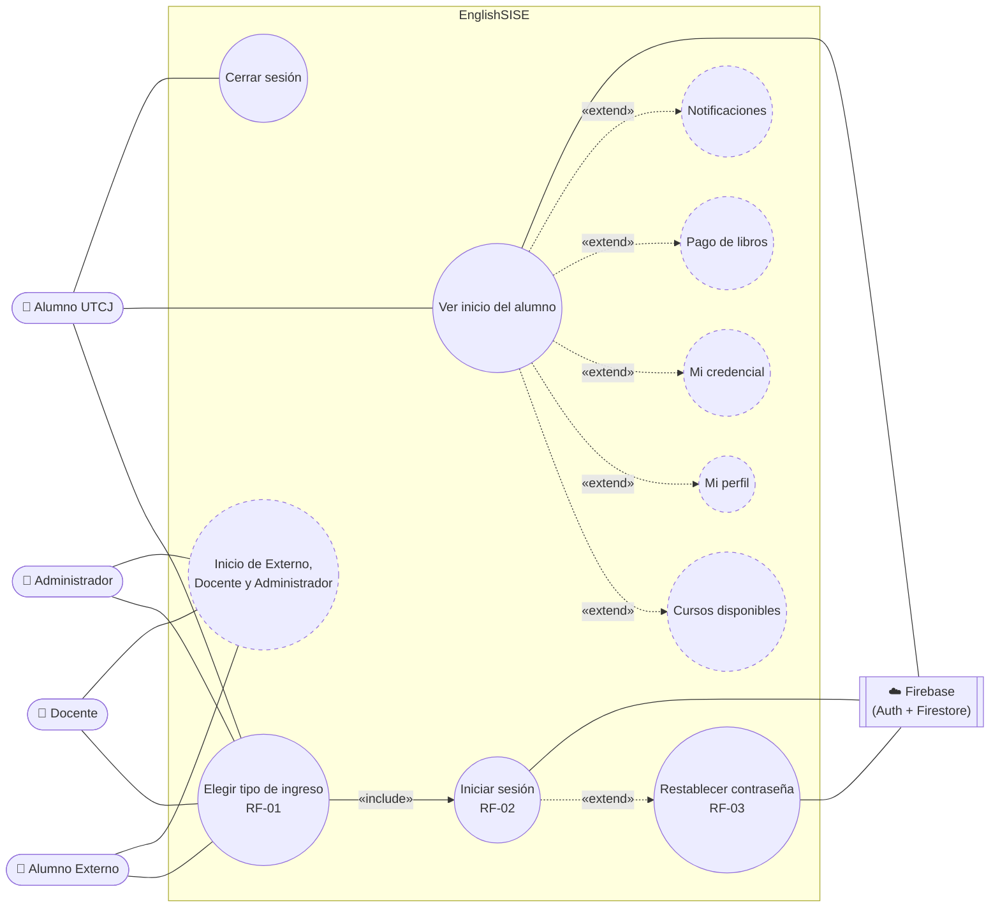

| Caso de uso | Estado | Dónde está |
|---|---|---|
| Elegir tipo de ingreso (RF-01) | ✅ Implementado | `MainActivity` |
| Iniciar sesión (RF-02) | ✅ Los 4 perfiles | `LoginActivity` + `UsuarioRepository.iniciarSesion()` |
| Restablecer contraseña (RF-03) | ✅ Implementado | `UsuarioRepository.restablecerContrasena()` |
| Ver inicio del alumno | ✅ Con nombre y matrícula reales | `InicioAlumnoUtcjActivity` |
| Cerrar sesión | ✅ Menú ☰ o *Más* | `InicioAlumnoUtcjActivity.cerrarSesion()` |
| Cursos, Perfil, Credencial, Pago de libros, Notificaciones | ⏳ «próximamente» | — |
| Inicio de Alumno Externo, Docente y Administrador | ⏳ Valida la cuenta y luego muestra «próximamente» | — |

---

### 18.2 Diagrama de clases

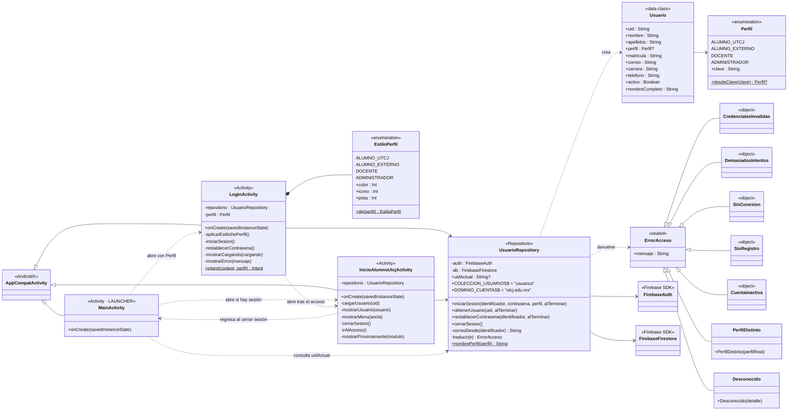

**Notas**

- Los parámetros `alTerminar` son *callbacks* de Kotlin: `(Usuario?, ErrorAcceso?) -> Unit` en `iniciarSesion` y `obtenerUsuario`, y `(ErrorAcceso?) -> Unit` en `restablecerContrasena`. Siempre llega uno de los dos valores, nunca ambos.
- `EstiloPerfil` es un `enum` privado anidado en `LoginActivity`. Relaciona cada perfil con su color, ícono y pista del campo de usuario.
- Las Activities nunca llaman a Firebase directamente: todo pasa por `UsuarioRepository` (RNF-17).

---

### 18.3 Diagramas de secuencia

#### 18.3.1 Inicio de sesión correcto (Alumno UTCJ)

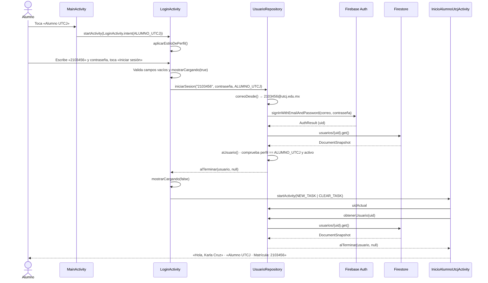

#### 18.3.2 Inicio de sesión rechazado

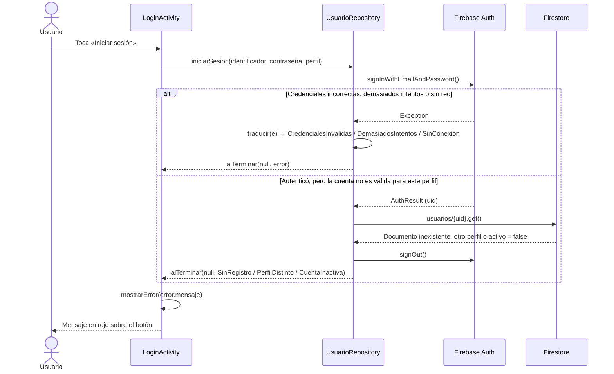

#### 18.3.3 Restablecer contraseña (RF-03)

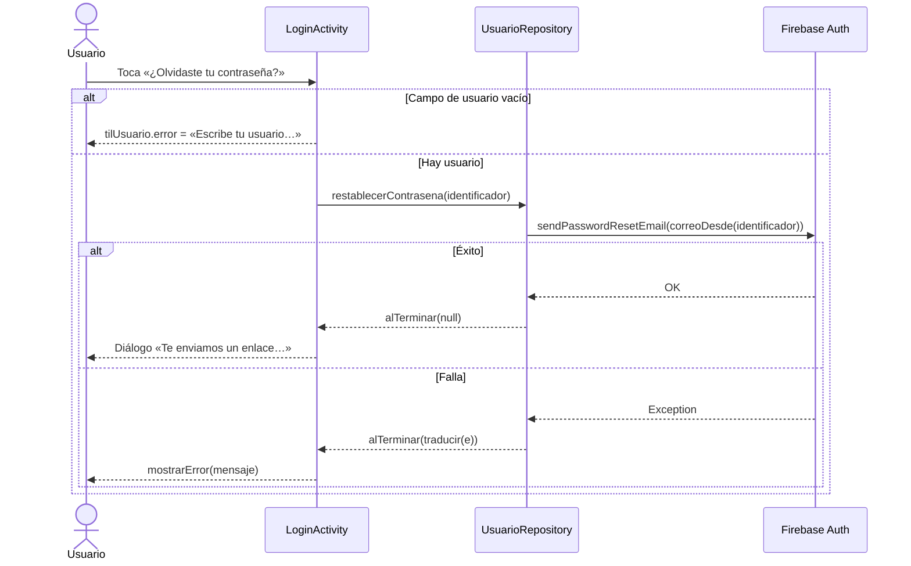

#### 18.3.4 Abrir la app con una sesión guardada

Firebase Auth conserva la sesión entre aperturas. `MainActivity` envía siempre al inicio del Alumno UTCJ, y ahí se valida el perfil.

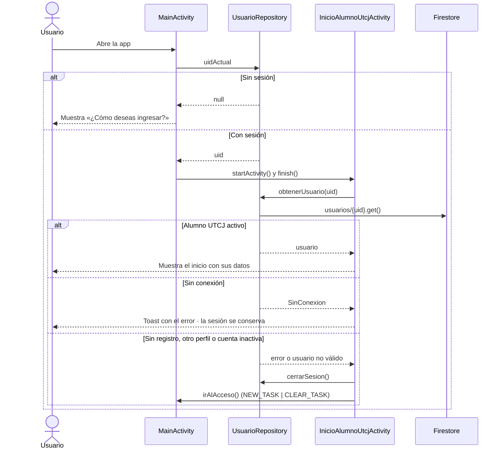

#### 18.3.5 Cerrar sesión

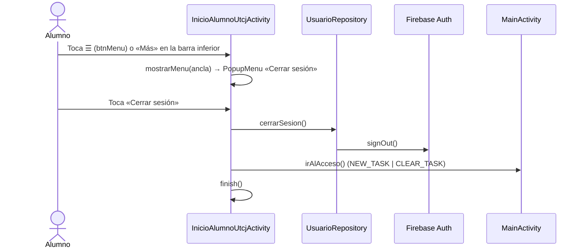

---

### 18.4 Diagrama de actividad: validación del acceso

Muestra las decisiones de `LoginActivity.iniciarSesion()` y `UsuarioRepository.iniciarSesion()`.

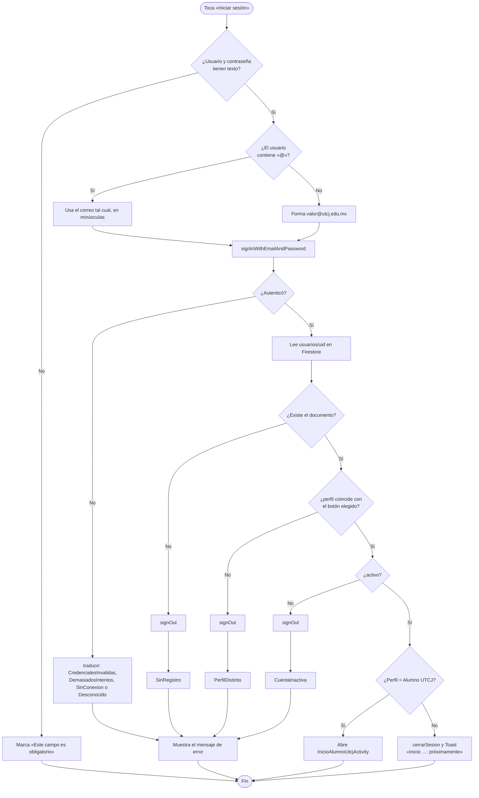

---

### 18.5 Diagrama de estados (navegación)

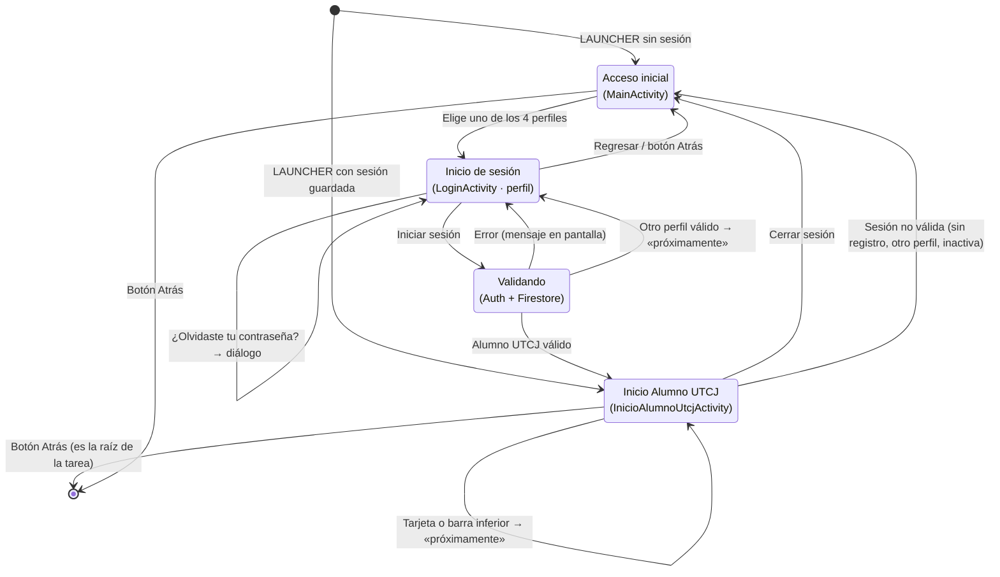

---

### 18.6 Diagrama de componentes

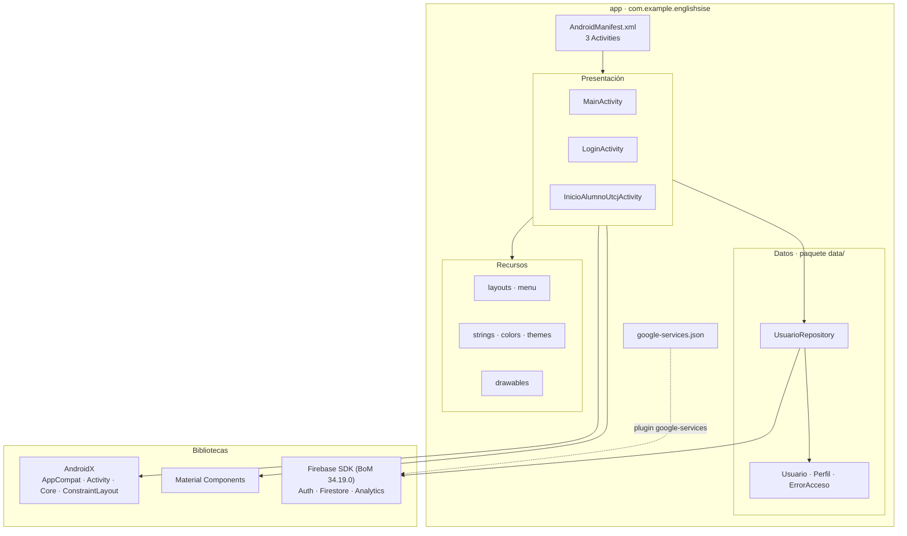

---

### 18.7 Diagrama de despliegue

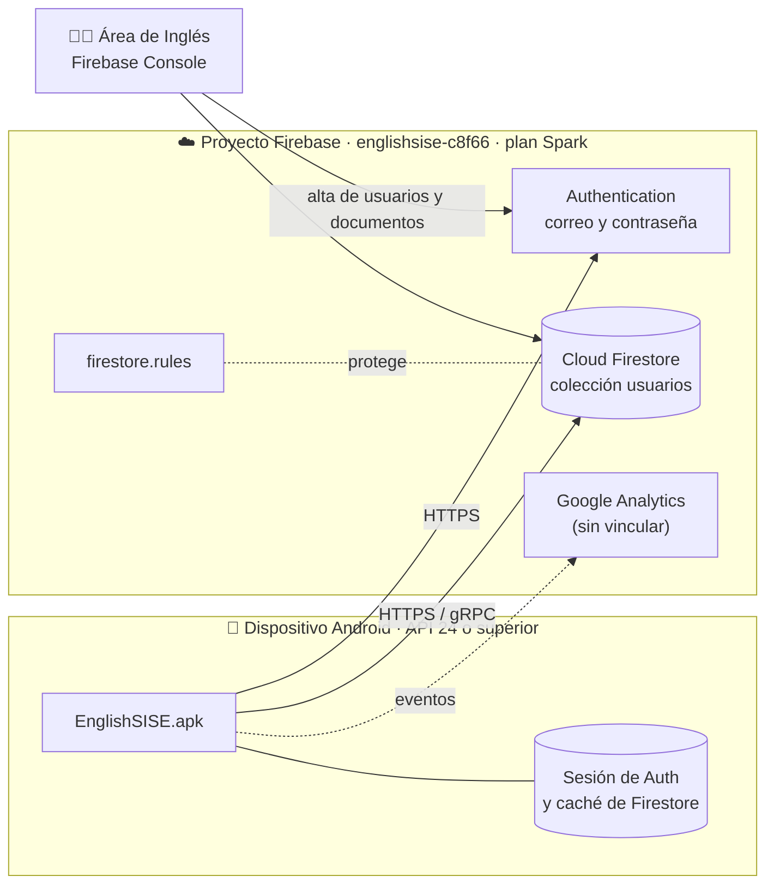

---

### 18.8 Modelo de datos (Firestore)

Cada cuenta de Firebase Auth tiene un documento en `usuarios` cuyo ID es el `uid` de esa cuenta.

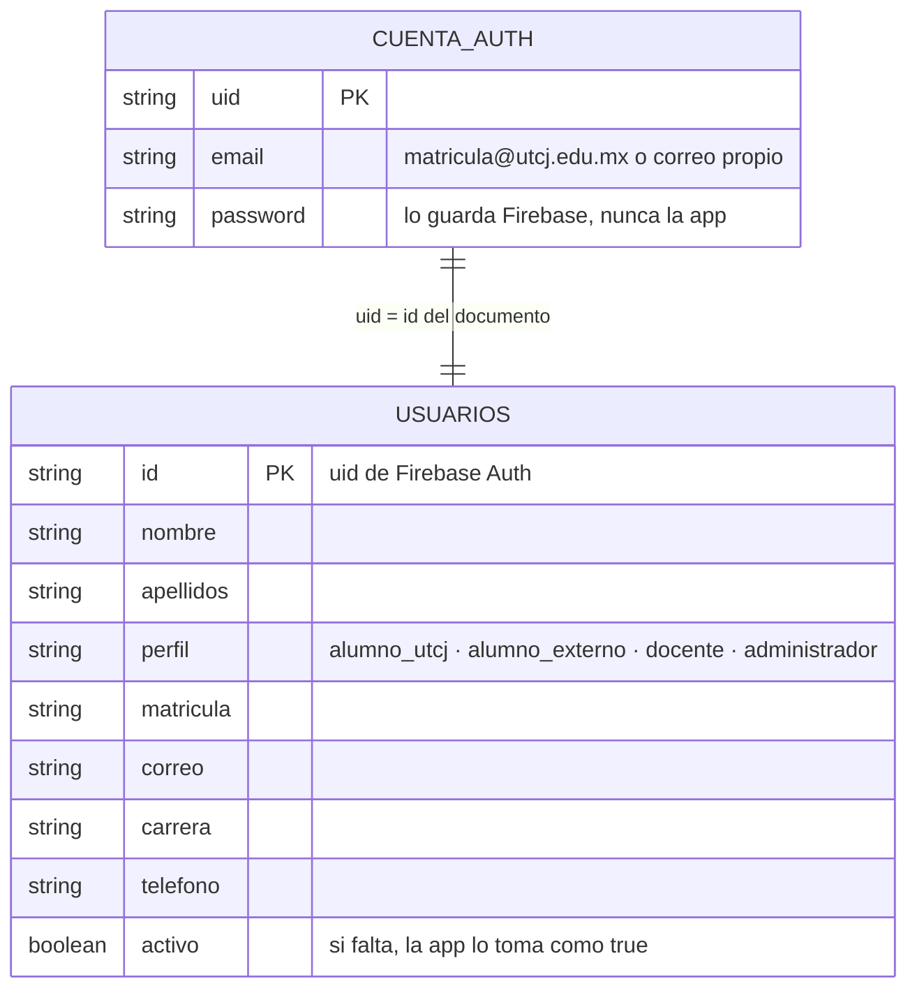

**Permisos (`firestore.rules`)**

| Operación sobre `usuarios/{uid}` | Quién puede |
|---|---|
| Leer | El propio usuario o un Administrador |
| Actualizar | El propio usuario, solo los campos `telefono` y `correo` (RF-05) |
| Crear o borrar | Solo un Administrador |
| Cualquier otra colección | Nadie (cerrado hasta que existan los módulos) |
